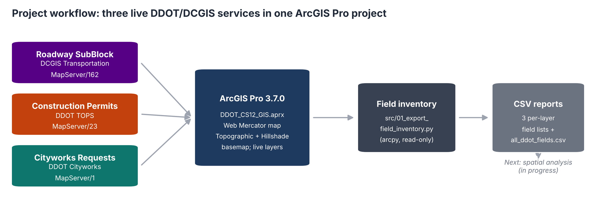
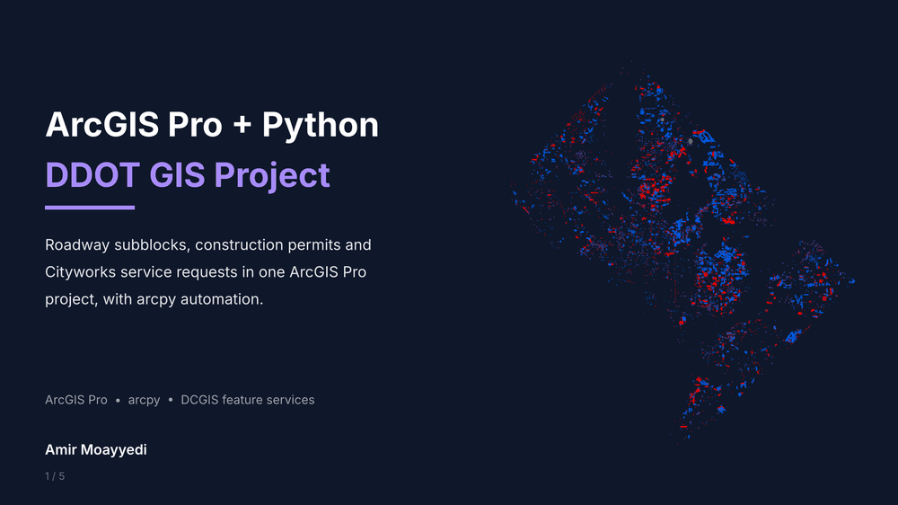
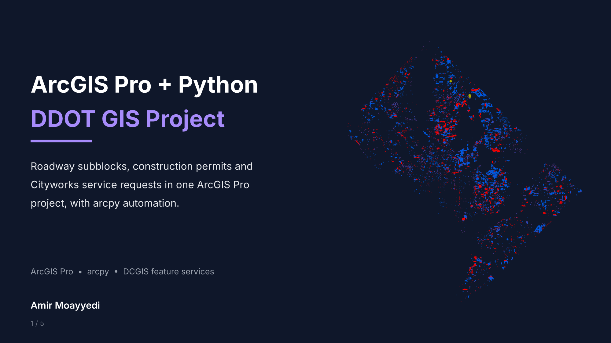
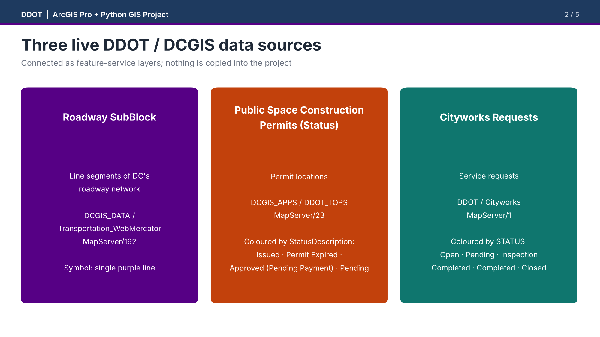
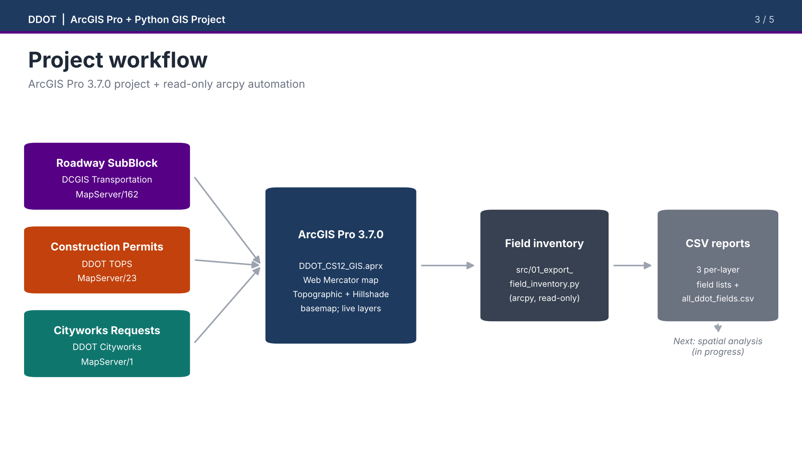
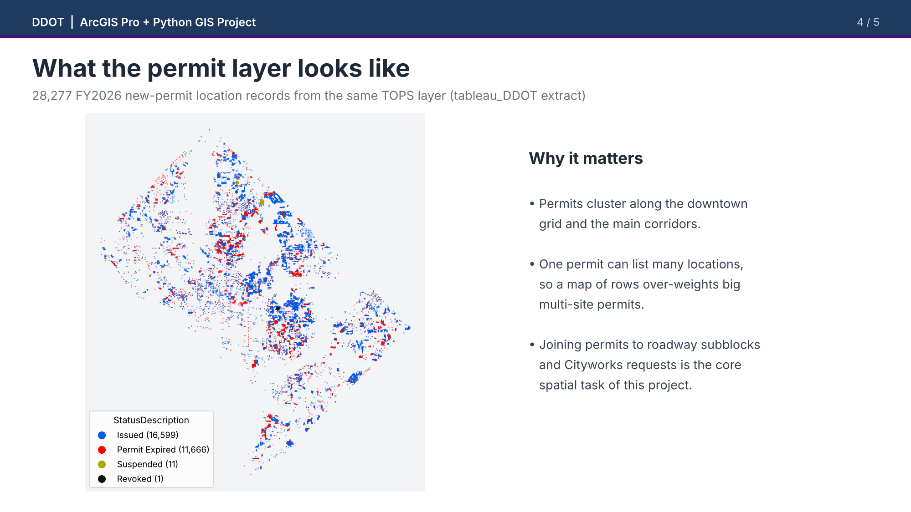
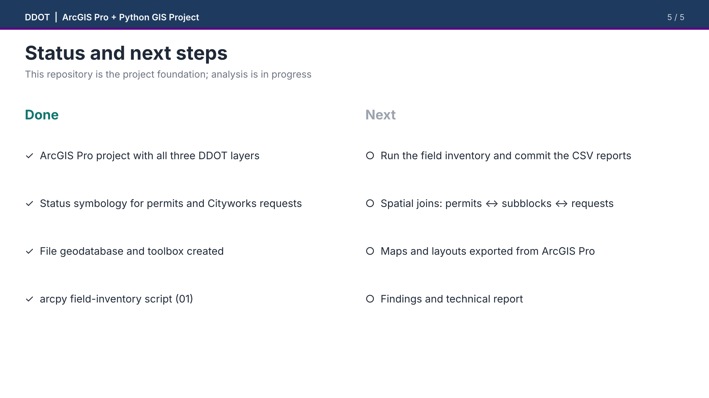
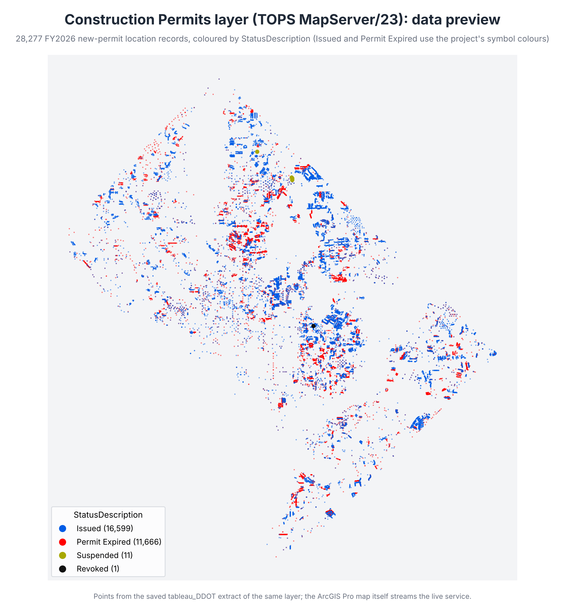
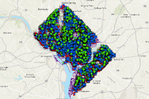

<div align="center">

# 🗺️ DDOT GIS Project: ArcGIS Pro + Python

### Roadway subblocks, public-space construction permits and Cityworks service requests in one ArcGIS Pro project, with arcpy automation


-6B7280)


**Amir Moayyedi** · DDOT CS-12 Data Scientist assessment (ArcGIS)

</div>

> 🚧 **Project status: foundation in place, analysis in progress.** This repository currently contains the ArcGIS Pro
> project with the three DDOT data layers, a file geodatabase and toolbox, and the first arcpy script (a field inventory).
> No analysis results are published here yet; see [Roadmap](#️-roadmap).

---

## 🧭 Project at a glance

<p align="center">
  
</p>

| | |
|---|---|
| **ArcGIS Pro project** | [`arcgispro/DDOT_CS12_GIS/DDOT_CS12_GIS.aprx`](arcgispro/DDOT_CS12_GIS/DDOT_CS12_GIS.aprx) (saved with ArcGIS Pro 3.7.0) |
| **Map** | One map, `Map`, in **WGS 1984 Web Mercator (EPSG:3857)**, extent covering Washington, DC |
| **Basemap** | Esri World Topographic Map + World Hillshade |
| **Operational layers** | 3 live DCGIS feature-service layers (below) |
| **Automation** | [`src/01_export_field_inventory.py`](src/01_export_field_inventory.py): read-only arcpy field inventory |

---

## 🎞️ Project in 5 slides

<p align="center">
  
</p>

<table>
  <tr>
    <td><a href="assets/slides/slide_01.png"></a></td>
    <td><a href="assets/slides/slide_02.png"></a></td>
    <td><a href="assets/slides/slide_03.png"></a></td>
  </tr>
  <tr>
    <td align="center"><sub>1 · Title</sub></td>
    <td align="center"><sub>2 · Three data sources</sub></td>
    <td align="center"><sub>3 · Project workflow</sub></td>
  </tr>
  <tr>
    <td><a href="assets/slides/slide_04.png"></a></td>
    <td><a href="assets/slides/slide_05.png"></a></td>
    <td></td>
  </tr>
  <tr>
    <td align="center"><sub>4 · What the permit layer looks like</sub></td>
    <td align="center"><sub>5 · Status & next steps</sub></td>
    <td></td>
  </tr>
</table>

<sub>Click any slide to open it at full size (2000 × 1125 px).</sub>

---

## 🛰️ Data sources

All three layers are **live connections** to public DC GIS ArcGIS REST services. The project stores the connection and the
symbology, not a copy of the data.

| Layer in the map | Service | Layer ID | Geometry | Symbology in the project | Visible by default |
|---|---|:---:|---|---|:---:|
| **Roadway SubBlock** | [`DCGIS_DATA/Transportation_WebMercator`](https://maps2.dcgis.dc.gov/dcgis/rest/services/DCGIS_DATA/Transportation_WebMercator/MapServer/162) | 162 | Line | Single symbol, purple line (label expression `ROUTENAME`, labels off) | ✅ |
| **DDOT – Public Space Construction Permits – Status** | [`DCGIS_APPS/DDOT_TOPS`](https://maps2.dcgis.dc.gov/dcgis/rest/services/DCGIS_APPS/DDOT_TOPS/MapServer/23) | 23 | Point | Unique values on `StatusDescription`: Permit Expired · Approved (Pending Payment) · Issued · Pending | ❌ |
| **CityworksRequest** | [`DDOT/Cityworks`](https://maps2.dcgis.dc.gov/dcgis/rest/services/DDOT/Cityworks/MapServer/1) | 1 | Point | Unique values on `STATUS`: Pending · Inspection Completed · Completed · Open · Closed (drawn at 1:100,000 and closer) | ❌ |

<table>
<tr>
<td width="62%">

</td>
<td>

**Preview of the permit layer**

To show what the construction-permit layer (TOPS layer 23) contains, the map on the left plots the **28,277 FY2026
new-permit location records** saved in the companion repository
[tableau_DDOT](https://github.com/SAMIRHOSEIN/tableau_DDOT), which were downloaded from this **same layer**.

- Issued: 16,599 records
- Permit Expired: 11,666
- Suspended: 11
- Revoked: 1

One permit can list many locations, so dense clusters partly reflect large multi-site permits.

<br>

**ArcGIS Pro project thumbnail**



<sub>The thumbnail ArcGIS Pro saved with the project (300 × 200 px): all three layers over the topographic basemap.</sub>

</td>
</tr>
</table>

---

## 🐍 Python automation

### `src/01_export_field_inventory.py`: field inventory of the map layers

A **read-only** arcpy script that documents the schema of the three DDOT layers before any analysis.

| | |
|---|---|
| **Runs in** | The ArcGIS Pro **Python window** with the project open (`arcpy.mp.ArcGISProject("CURRENT")`) |
| **Finds layers by** | Normalized layer name (lower case, letters and digits only) containing `roadwaysubblock`, `publicspaceconstructionpermits` or `cityworksrequest` |
| **Reads** | `arcpy.ListFields()` for each layer. It never edits data |
| **Writes** | One CSV per layer plus a combined file, in `reports/field_inventory/` |
| **Columns** | `source_layer`, `field_order`, `field_name`, `field_alias`, `field_type`, `field_length`, `field_precision`, `field_scale`, `nullable`, `required`, `editable`, `domain` |

```text
reports/field_inventory/
├── roadway_subblocks_fields.csv
├── construction_permits_fields.csv
├── cityworks_requests_fields.csv
└── all_ddot_fields.csv
```

**How to run**

1. Open `arcgispro/DDOT_CS12_GIS/DDOT_CS12_GIS.aprx` in ArcGIS Pro and open the map with the three layers.
2. Open **View → Python window**.
3. Run the script, for example:

```python
exec(open(r"<path-to-repo>\src\01_export_field_inventory.py", encoding="utf-8").read())
```

The console prints the map name, the output folder, the layers found and `SUCCESS: <layer> - <n> fields` for each export.
If a layer is missing it prints `NOT FOUND` instead of failing.

> **Note on the output location:** the script places `reports/` at the repository root only when the project folder sits
> inside a directory named `archispro`. In this repository the folder is named `arcgispro`, so the reports are currently
> written next to the project, in `arcgispro/DDOT_CS12_GIS/reports/field_inventory/`.

---

## 📁 Repository structure

```text
arcgisANDpython_DDOT/
├── README.md
├── .gitignore
├── src/
│   └── 01_export_field_inventory.py          # arcpy field inventory (read-only)
├── arcgispro/
│   └── DDOT_CS12_GIS/
│       ├── DDOT_CS12_GIS.aprx                # ArcGIS Pro project (map, layers, symbology)
│       ├── DDOT_CS12_GIS.atbx                # project toolbox (empty so far)
│       ├── DDOT_CS12_GIS.gdb/                # project file geodatabase (no feature classes yet)
│       ├── ImportLog/                        # ArcGIS Pro import log ("No error, no warning")
│       └── Index/                            # ArcGIS Pro search index + project thumbnail
└── assets/                                   # README images
    ├── workflow.png · layer_preview_map.png · arcgis_pro_project_thumbnail.png
    ├── slides/ · slides_preview.gif
    └── make_readme_figures.py                # regenerates the README images
```

---

## 🚀 Getting started

**Requirements**
- **ArcGIS Pro 3.x** (the project was saved with 3.7.0) with a licence. `arcpy` ships with ArcGIS Pro and cannot be
  installed from pip.
- Internet access to `maps2.dcgis.dc.gov` (layers) and ArcGIS Online (basemap).

**Steps**
1. Clone the repository:
   ```bash
   git clone https://github.com/SAMIRHOSEIN/arcgisANDpython_DDOT.git
   ```
2. Open `arcgispro/DDOT_CS12_GIS/DDOT_CS12_GIS.aprx`. The project uses relative paths, so it opens from any folder.
3. Turn on **DDOT – Public Space Construction Permits – Status** and **CityworksRequest** in *Contents*, since only Roadway
   SubBlock is visible by default.
4. Run the field inventory as described [above](#-python-automation).

**Regenerate the README images** (optional; standard Python, no ArcGIS needed). The permit preview reads the saved CSV
from a local clone of `tableau_DDOT`:

```bash
pip install matplotlib pandas pillow
python assets/make_readme_figures.py --permits-csv ../tableau_DDOT/data/raw/fy2026_new_permits_all_api_records.csv
```

---

## 🛣️ Roadmap

| | Task |
|:---:|---|
| ✅ | ArcGIS Pro project with the three DDOT layers and status symbology |
| ✅ | Project file geodatabase and toolbox |
| ✅ | arcpy field-inventory script (`01`) |
| ⬜ | Run the field inventory and commit the CSV reports |
| ⬜ | Spatial analysis: relate permits and Cityworks requests to roadway subblocks |
| ⬜ | Export maps and layouts from ArcGIS Pro |
| ⬜ | Document findings and the method in a technical report |

---

## 🔗 Related projects

The same DDOT data is analysed in two companion repositories:

| Repository | Focus |
|---|---|
| [tableau_DDOT](https://github.com/SAMIRHOSEIN/tableau_DDOT) | FY2026 construction-permit approval times (business days), with a Tableau dashboard |
| [Python_DDOT](https://github.com/SAMIRHOSEIN/Python_DDOT) | FHWA roadway functional class for 2026 utility permit locations, using DDOT LRS matching |

---

<div align="center">

**Amir Moayyedi**
Data: District Department of Transportation (DDOT) and DC GIS open data · Basemap: Esri

</div>
